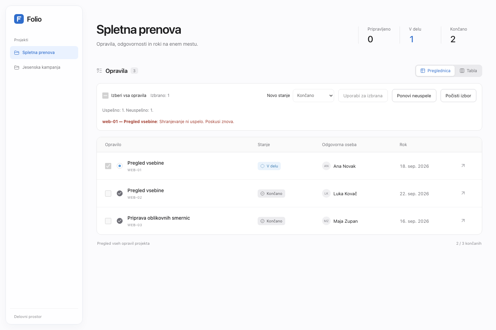
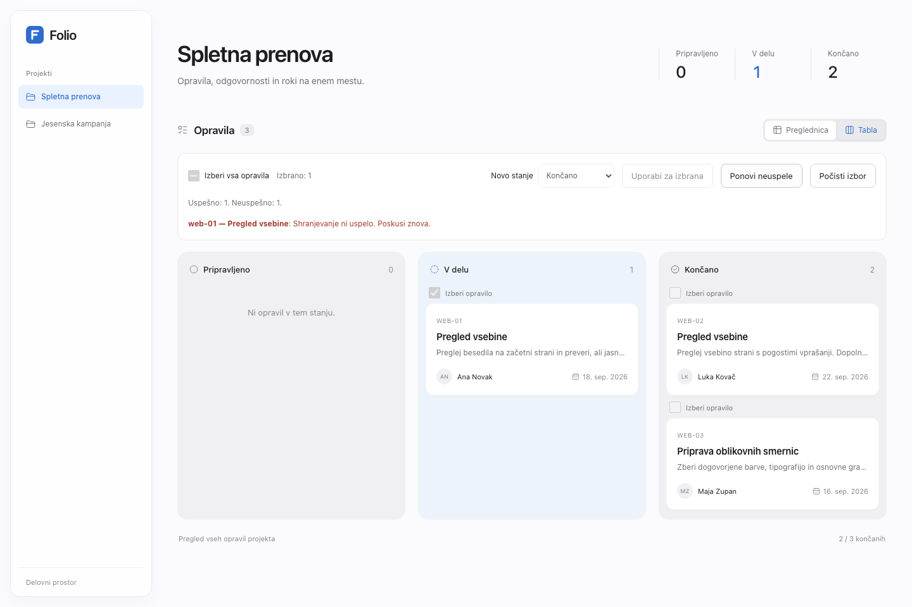

# Preverjena priprava P02

21. september 2026. Pripravljena je druga pilotna naloga P02 v0.1:
množična sprememba stanja opravil z neodvisnimi izidi in ponavljanjem samo
neuspelih zapisov. **Ta dokument poroča o preverjanju reference in meril.**
Pozneje izvedeni modeli A, B in C so ločeno opisani v
[rezultatih P02](p02-results.md); vsak je opravil 72/72 neodvisnih preverjanj.

## Rezultati

- Preverjanje testnih tipov ter sloga, tipov in gradnje reference: uspešno.
- Celotna referenca: **72/72 preverjanj** — 38 osnovnih, 8 razvojnih P02
  in 26 končnih P02. Vmesnik je preverjen na računalniškem in mobilnem prikazu.
- Namerno napačne rešitve: **10/10 zaznanih**. Vse napačne različice se
  prevedejo; odpovedale so na pričakovanih vsebinskih preverjanjih.
- Pozitivna kontrola z zaporednim pošiljanjem: **13/13 končnih scenarijev**
  na računalniškem prikazu. Testi dovolijo veljavno zaporedno in sočasno
  izvedbo ter ne zahtevajo vrstnega reda ID-jev referenčne implementacije.
- Pregled videza: preglednica in tabla pri 1440 × 960 ter 390 × 844;
  brez napak JavaScript in brez vodoravnega razširjanja celotne strani.
  Tabela in tabla uporabljata lastno vodoravno drsenje, kot izhodišče.

Dokazila so v [referenčnem povzetku](../reports/P02-reference-summary.json),
[preverjanju napak](../reports/P02-mutation-summary.json),
[pozitivni kontroli](../reports/P02-sequential-control-summary.json) in
[pregledu prikaza](../reports/P02-visual-check.json). Povzetek pozitivne
kontrole vsebuje točna nadomestila kode in kontrolno vsoto spremenjene
datoteke, da je mogoče kopijo ponovno sestaviti iz preverjene reference.

Preverjanja so uporabljala Node.js 24.11.1 in zaklenjene odvisnosti; osnovni
commit je `6dc1193f32a1fc00722fbc0983907d32b908cb51`. Kontrolne vsote v
poročilih povezujejo izide s konkretnimi navodili, testi in referenco.
Skupni strežnik se naloži iz pripetega izhodišča, ne iz kandidatove kode.
Izvirni Folio ter navodila, rešitve in arhivi zagonov P01 so nespremenjeni.

## Zaznane napake

| ID | Namerno odstopanje | Scenarij |
| --- | --- | --- |
| M01 | Zapis v drugo istoimensko opravilo | E05 |
| M02 | Ponovno pošiljanje uspešnih in neizbranih opravil | E07 |
| M03 | Strežnik shrani, prikaz ostane zastarel | E08 |
| M04 | Sočasni odgovor prepiše že prikazano posodobitev | E04 |
| M05 | Prikaz še nepotrjene spremembe | E06 |
| M06 | Povzetek šteje le uspehe zadnje ponovitve | E07 |
| M07 | Dve zahtevi za en izbrani ID | E06 |
| M08 | Izguba izbora ob preklopu pogleda | E01 |
| M09 | Čiščenje ohrani stari cilj | E03 |
| M10 | Uspešna opravila ostanejo izbrana | E07 |

## Posnetki

Primer delnega uspeha: eno opravilo je ostalo nespremenjeno zaradi zavrnitve,
drugo je shranjeno. Ponovi se lahko samo neuspešno opravilo.

Mobilna posnetka: [preglednica](images/P02-mobile-table.png) in
[tabla](images/P02-mobile-board.png).

## Izvedeni piloti in naslednji korak

Izvajalnik je razširjen na P02 in tehnična kopija brez klica modela je
opravila 46/46 preverjanj znotraj izolacije. Podrobnosti so v
[pripravi pilota](p02-setup.md), skupni pogoji pa v
[protokolu P02/1](p02-pilot-protocol.md). Ta dokument ohranja rezultate
reference; modelske izvedbe so poročane v [pregledu P02](p02-results.md).
Vsi trije postopki so zaključeni, poraba je popolno zabeležena.
Glavni raziskovalni
protokol in končni obseg meritev še nista zamrznjena.

Izidi potrjujejo delovanje reference na navedenih primerih in zaznavo
desetih napak. Ne zagotavljajo popolnosti testov, razlik med postopki A–C
ali uspešne agentove povratne zanke po pregledu.
